# Pendulum World Model Lab

I use this repository to study neural dynamics models and model predictive control (MPC) in Gymnasium's `Pendulum-v1` environment. I started with one-step state prediction and progressively added open-loop evaluation, MPC, planner comparisons, and multi-step training. I plan to extend the work to recurrent and visual world models.

I keep the code, measurements, plots, and experiment notes together so I can revisit each result. Exact numbers may vary across hardware and stochastic runs.

## Progress

- [x] Configure Ubuntu, a Python virtual environment, and CUDA-enabled PyTorch
- [x] **Experiment 01:** Train and evaluate a one-step neural dynamics model
- [x] **Experiment 02:** Evaluate 100-step open-loop predictions
- [x] **Experiment 03:** Evaluate learned-model MPC against zero-torque and random baselines
- [x] **Experiment 04:** Compare MPC planning horizons (H=5, 10, 20) over 10 paired seeds
- [x] **Experiment 05:** Compare Random Shooting and CEM over 30 paired seeds at H=10 and H=20
- [x] **Experiment 06:** Multi-step training, projection, open-loop evaluation, MPC and closed-loop diagnostics
- [ ] **Experiment 07:** First recurrent latent-state world model (RSSM preparation)
- [ ] Explore latent/visual world models
- [ ] Explore small VLA policies

## Environment

Experiments were performed on a Lenovo LOQ 15IRH8 with Ubuntu 22.04.5 LTS, Intel Core i5-13420H, approximately 16 GB RAM, and NVIDIA GeForce RTX 2050 (4 GB VRAM). The tested environment used Python 3.10.12, PyTorch `2.11.0+cu126`, and a working CUDA device. Larger models may require Google Colab or other cloud GPUs.

## Problem and learned dynamics model

`Pendulum-v1` exposes the observation

```text
s_t = [cos(theta_t), sin(theta_t), angular_velocity_t]
a_t in [-2, 2]  # continuous torque
```

The neural network receives `[s_t, a_t]` (four input values) and predicts a **state delta** (three output values):

```text
delta_s_t       = s_(t+1) - s_t
predicted_s_next = s_t + predicted_delta_s_t
```

Architecture: MLP `4 -> 128 -> 128 -> 3`, ReLU activations, Adam optimizer (learning rate `1e-3`), batch size 256. Training minimizes MSE of **normalized state deltas**. Normalization statistics are estimated from training data only. Train and test trajectories use distinct reset seeds.

## Setup

Run from the repository root:

```bash
python3 -m venv .venv
source .venv/bin/activate
python -m pip install --upgrade pip

# Install CUDA-enabled PyTorch using the official selector:
# https://pytorch.org/get-started/locally/
# I used torch 2.11.0+cu126.
python -m pip install -r requirements.txt
python -c 'import torch; print(torch.__version__, torch.cuda.is_available())'
```

If you already have a working environment, activate it instead. On my laptop:

```bash
source ~/projects/world-models/.venv/bin/activate
```

Do not install a separate system-wide CUDA Toolkit just for these experiments unless a later dependency actually requires it. CPU execution is also possible for smaller runs.

## Reproduce the experiments

Run the scripts from the repository root:

```bash
# Experiment 01: train the model and save its checkpoint
python src/train_one_step.py

# Plot the training-loss measurements from the first run
python src/plot_first_run.py

# Experiment 02: 100-step open-loop predictions
python src/evaluate_rollout.py

# Experiment 03: receding-horizon, random-shooting MPC
python src/evaluate_mpc.py

# Experiment 04: paired comparison of planning horizons
python src/evaluate_horizons.py --episodes 10 --horizons 5 10 20

# Experiment 05: Random Shooting vs. CEM (30 paired seeds)
python src/compare_planners.py --episodes 30 --horizons 10 20

# Experiment 06: fine-tune and evaluate four prediction configurations
python src/experiment06.py --epochs 15 --train-episodes 100 \
  --train-horizon 5 --eval-episodes 20 --rollout-horizon 100 --mpc-episodes 10

# Experiment 06 diagnostics (requires saved checkpoints and trajectory CSV)
python src/diagnose_experiment06.py --seeds 70002 70006
python src/analyze_projection_counterfactual.py --seed 70006 --steps 30 55
python src/find_projection_divergence.py --seeds 70002 70006
```

The training script saves its model and normalization statistics to `runs/one_step/pendulum_world_model.pt`. That path is the default checkpoint for the later experiments. Training runs and model weights are intentionally not committed to Git; observed results and figures are included under `results/`.

## Experiment 01 — One-step neural dynamics prediction

My first training run used the script preserved as [`src/original_train_world_model.py`](src/original_train_world_model.py).

| Measurement | Observed value |
|---|---:|
| Training MSE, epoch 5 (normalized deltas) | 0.001486 |
| Training MSE, epoch 10 | 0.000817 |
| Training MSE, epoch 15 | 0.000762 |
| Training MSE, epoch 20 | 0.000629 |
| Training MSE, epoch 25 | 0.000560 |
| Training MSE, epoch 30 | 0.000557 |
| One-step test MSE (original state scale) | 0.0001419463 |
| No-change baseline MSE (original state scale) | 0.1061588004 |

The test MSE was approximately **748 times smaller** than the simple no-change baseline's MSE on that run. The baseline predicts `s_(t+1) = s_t`; because the target is `Y_test = s_(t+1) - s_t`, its squared error simplifies to `mean(Y_test ** 2)`.

Training MSE above is on *normalized deltas*, while test MSE is on the *original state scale*. Their numerical magnitudes must not be compared directly. The maintained training script reports comparable train/test metrics in matching spaces. I did not explicitly seed the action sampler in the initial run, so its exact measurements may differ on repetition.

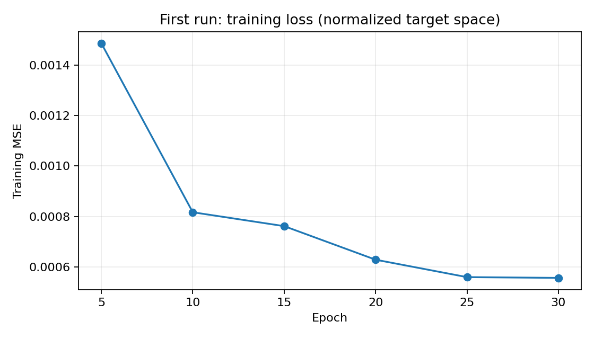

## Experiment 02 — Multi-step open-loop prediction

I evaluated 100-step recursive predictions over 10 independently initialized episodes, using the same action sequences in the model and `Pendulum-v1`. After the initial state, the predictor did not receive intermediate ground-truth states.

| Prediction step | Mean state MSE |
|---|---:|
| 1 | 0.000012 |
| 5 | 0.000564 |
| 10 | 0.004254 |
| 20 | 0.009564 |
| 50 | 2.329447 |
| 100 | 6.113632 |

Accurate one-step predictions did not translate into accurate long-horizon predictions: errors grew sharply on some trajectories. Plausible factors include compounding errors, distribution shift under recursive predictions, and the lack of an enforced `cos²(theta) + sin²(theta) = 1` constraint. I have not isolated the contribution of each factor.

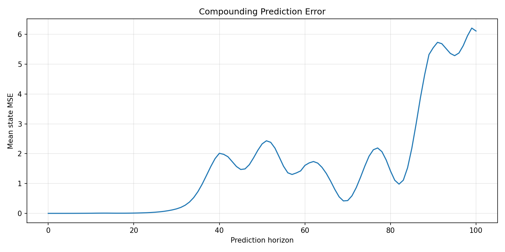

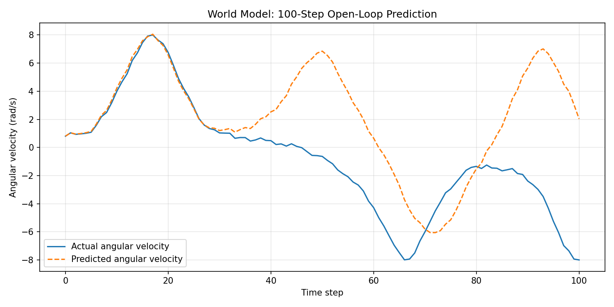

[Detailed report — Experiment 02](docs/02-multi-step-prediction.md)

## Experiment 03 — Learned-model MPC

I used the learned dynamics model in a receding-horizon MPC controller with random shooting to evaluate candidate torque sequences. At each environment step, MPC selected the lowest-cost simulated sequence, executed **only its first action**, observed the actual next state, and replanned.

### Evaluation protocol

- Environment: `Pendulum-v1`, 200 steps per episode
- Shared environment reset seeds: `21000`, `21001`, `21002`
- Baselines: zero torque (`zero`) and uniformly random torque (`random`)
- MPC horizon: **10 steps**; candidate sequences: **256** per decision
- Actions: continuous torque in `[-2, 2]`
- Selection objective: cumulative `theta² + 0.1 * angular_velocity² + 0.001 * torque²` computed over *predicted next states*
- Primary metric: episode return (**higher / closer to zero is better**)

### Observed episode returns

| Seed | Zero torque | Random torque | Learned-model MPC |
|---|---:|---:|---:|
| 21000 | -503.69 | -637.70 | **-0.58** |
| 21001 | -481.39 | -955.82 | **-0.37** |
| 21002 | -1313.79 | -1269.40 | **-252.81** |
| **Mean ± population SD** | **-766.29 ± 387.25** | **-954.31 ± 257.89** | **-84.59 ± 118.95** |

MPC outperformed both baselines **on all three evaluated seeds**, achieving near-zero episode return on two. Performance was less consistent on seed `21002`; these three episodes are insufficient to establish robust or generalizable performance. The improvement in *mean episode return* versus the random baseline was approximately **869.72 reward points** (not a percent improvement).

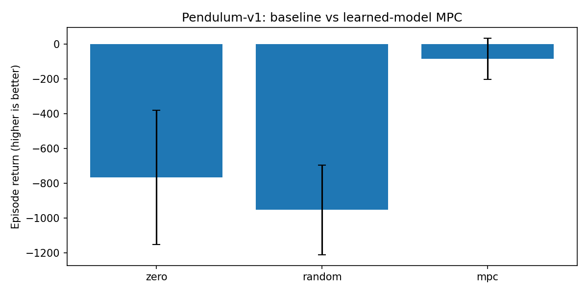

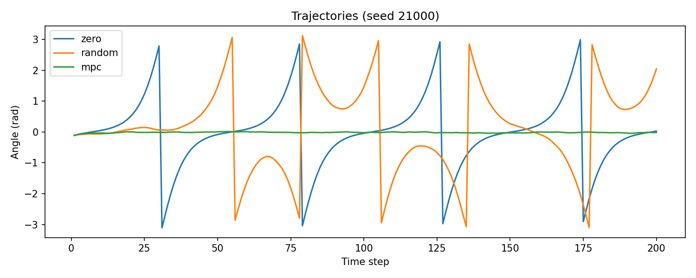

The angle plot shows **only seed 21000** and should not be interpreted as evidence that all MPC episodes remained upright. The apparent jumps between `+pi` and `-pi` on baseline trajectories result from angle wrapping.

Data and figures: `results/mpc/metrics.json`, `results/mpc/trajectories.csv`, `results/mpc/returns.png`, `results/mpc/angles.png`.

[Detailed report — Experiment 03](docs/03-model-predictive-control.md)

## Experiment 04 — MPC planning-horizon ablation

I compared random-shooting MPC horizons using the same learned dynamics checkpoint on 10 common environment reset seeds (`21000`–`21009`), 200 environment steps per episode, and 256 candidate action sequences per decision. Only the planning horizon changed (`H=5`, `H=10`, `H=20`). Results are exploratory, not a statistically conclusive benchmark.

| Horizon | Mean return ± SD | Median return | Mean final-50 stable fraction | Mean planning time |
|---|---:|---:|---:|---:|
| 5 | -849.57 ± 586.09 | -1065.38 | 30% | 0.8 ms |
| 10 | -223.34 ± 190.89 | -251.09 | 100% | 1.3 ms |
| 20 | -219.35 ± 221.94 | -124.38 | 100% | 2.5 ms |

Here a time step counts as *stable* if the wrapped angle magnitude is below `0.2 rad` **and** the angular-velocity magnitude is below `0.5 rad/s`. The stability percentage aggregates the fraction of the **last 50 steps** satisfying that diagnostic criterion; it is not a general safety guarantee. In this particular run, all ten H=10 and H=20 episodes reported a final-window fraction of `1.00`, while only three H=5 episodes did.

H=5 struggled to swing up from several initial states. H=10 and H=20 both achieved the final-window stability criterion across the tested seeds, but H=20's mean return advantage was only `3.99` points and its average planning time was approximately `1.9×` higher. H=10 had the better total return in six of ten paired episodes. Longer horizons also enlarge the action-sequence search space, so these results cannot isolate model-prediction error from random-shooting optimization difficulty.

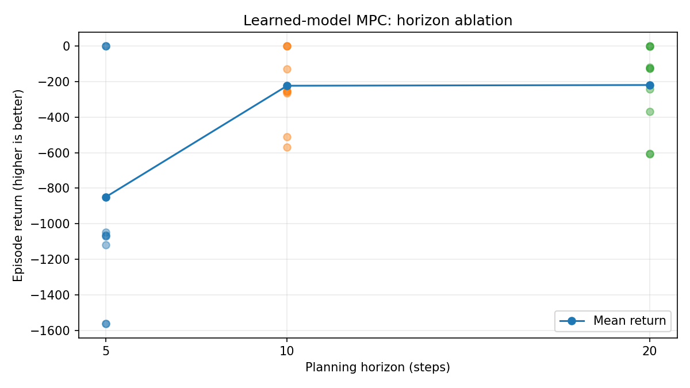

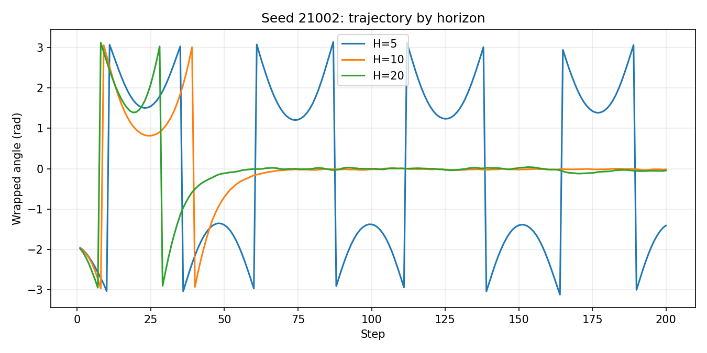

The trajectory plot for seed `21002` illustrates that H=5 continued rotating while H=10 and H=20 approached and maintained the upright configuration later in the episode. Discontinuities at `±π` are caused by angle wrapping.

Data and figures: `results/mpc_horizon_ablation/metrics.json`, `results/mpc_horizon_ablation/trajectories.csv`, and the two figures above.

[Detailed report — Experiment 04](docs/04-mpc-horizon-ablation.md)

## Experiment 05 — Random Shooting vs. CEM

I compared Random Shooting with CEM in receding-horizon MPC, keeping the same world-model checkpoint, planning cost, and environment reset seeds (`21000`–`21029`). Both evaluated **1,024 candidate action sequences per decision**: Random Shooting sampled 1,024 uniformly; CEM performed four rounds of 256 samples with a 10% elite fraction. Each episode lasted 200 steps. Horizons were 10 and 20 steps.

| Horizon | Planner | Mean return ± SD | Median return | Final-50 stability | Planning time |
|---|---|---:|---:|---:|---:|
| 10 | Random Shooting | -232.52 ± 188.33 | -189.47 | 100% | 1.5 ms |
| 10 | CEM | **-195.03 ± 170.72** | -129.81 | 100% | 6.3 ms |
| 20 | Random Shooting | -248.11 ± 208.56 | -180.49 | 100% | 2.8 ms |
| 20 | CEM | **-170.53 ± 127.97** | -121.68 | 100% | 11.5 ms |

CEM improved mean episode return by **37.49** points at H=10 and **77.58** at H=20, but required approximately **4.2×** and **4.1×** the mean planning time, respectively. It was **not uniformly better**: for example, at seed 21014 and H=10, CEM returned `-784.40` versus Random Shooting's `-469.31`. The 100% final-50 stability reflects only the upright criterion within that window; it does not imply low cost or stable behavior throughout each episode.

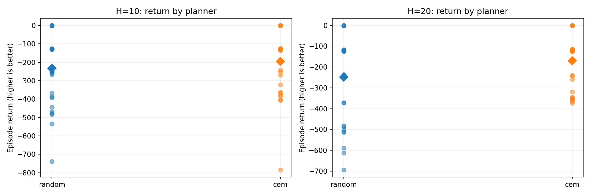

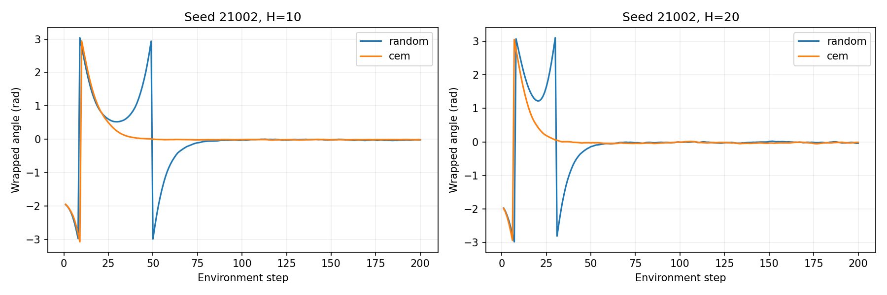

Data and figures: `results/mpc_planner_comparison/metrics.json`, `results/mpc_planner_comparison/trajectories.csv`, and the two figures above.

[Detailed report — Experiment 05](docs/05-random-shooting-vs-cem.md)

## Experiment 06 — Improving world-model rollout accuracy

I compared the original one-step model and a model fine-tuned with a five-step rollout loss, each with and without unit-circle projection at inference. The two fine-tuned configurations share the same weights; projection was not used during training. I evaluated 20 common open-loop trajectories (100 steps each) and MPC returns over 10 common reset seeds (70000–70009).

| Variant | Rollout MSE H=20 | Rollout MSE H=50 | Rollout MSE H=100 | Mean MPC return ± population SD |
|---|---:|---:|---:|---:|
| Baseline | 0.05513 | 1.09356 | 1.55375 | -164.685 ± 168.004 |
| Projection only | 0.04750 | 0.41052 | 2.06025 | -164.702 ± 168.193 |
| Multi-step only | **0.00468** | **0.14542** | **1.46073** | **-140.001 ± 131.313** |
| Multi-step + projection | **0.00436** | 0.19291 | 1.46651 | -152.879 ± 136.295 |

Five-step fine-tuning improved short- and medium-horizon prediction accuracy. The average MPC improvement was much smaller and concentrated almost entirely in two seeds (`70002` and `70006`). Projection kept the predicted cosine/sine pair on the unit circle, but did not consistently improve return.

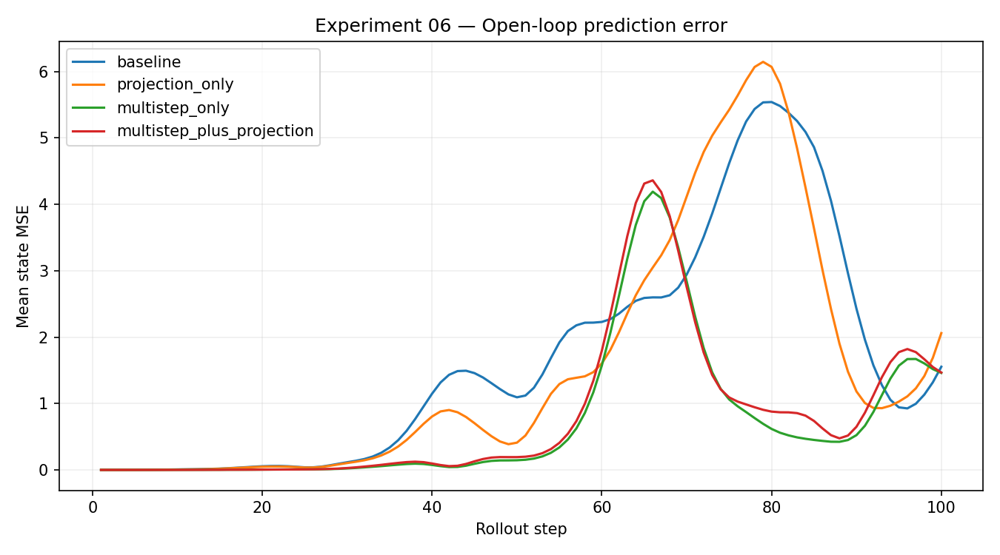

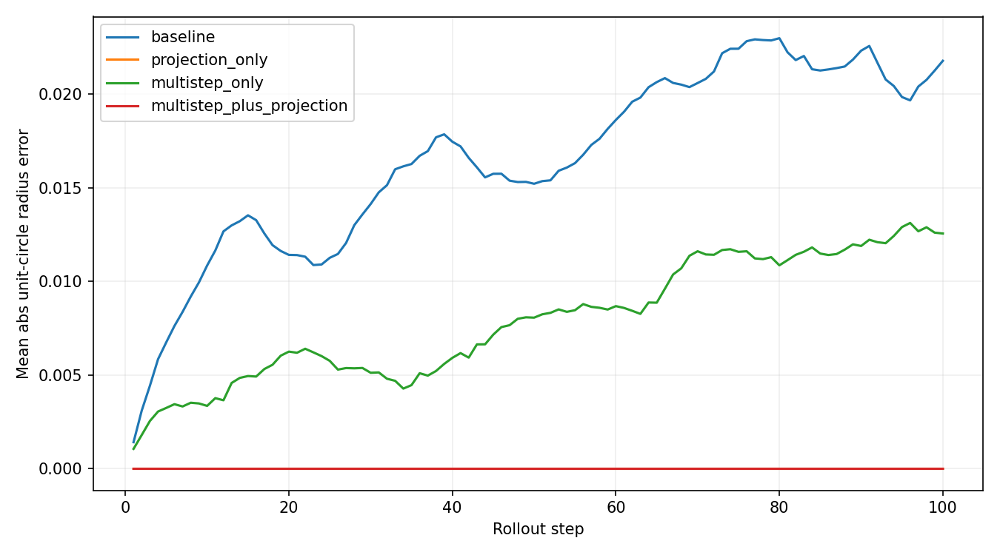

I reran seeds `70002` and `70006` with trajectory logging; the episode returns matched the earlier runs. In the fine-tuned model comparison, the first difference between projected and unprojected actions occurred at step **53** for seed `70002` and step **14** for seed `70006`, before the measured state trajectories diverged at the next steps. An additional identical-state/candidate comparison on steps 30–55 of seed `70006` did not change any chosen actions, but it used newly sampled candidates and missed the earlier divergence at step 14. I have not reconstructed the original candidate-cost rankings at that step.

[Main Experiment 06 report](docs/06-improving-world-model-rollouts.md) · [Closed-loop diagnostics](docs/06-closed-loop-diagnostics.md) · [Projection counterfactual](docs/06-projection-counterfactual.md)

## Interpretation and limitations

These measurements address different questions: one-step MSE measures local prediction, long-horizon rollout MSE measures accumulated error, and MPC return measures closed-loop decisions. Improvements in one metric do not imply improvements in the others. State-space MSE also mixes cosine/sine and angular velocity on different scales.

The Experiment 06 result is limited to one fine-tuning run, 20 evaluation trajectories, and 10 MPC seeds. MPC trajectories are policy-dependent, so a model's prediction errors on its own visited states are not directly comparable to another model's errors on different states. The unit-circle projection imposes geometric validity but cannot guarantee correct dynamics or better decisions. I keep model checkpoints (`*.pt`) locally rather than committing them.

## Next steps

1. **Experiment 07:** Implement a small recurrent latent-state dynamics model and compare reconstruction/prediction over held-out sequences. I will use this as a baseline before implementing a stochastic RSSM.
2. Extend to stochastic latent dynamics, inference/prior distributions and imagined rollouts after establishing a working recurrent baseline.
3. Later, replace state vectors with rendered observations and investigate visual world models.

See [the roadmap](docs/roadmap.md) for longer-term work.

## Repository layout

```text
pendulum-world-model-lab/
├── README.md
├── LICENSE
├── requirements.txt
├── .gitignore
├── src/
│   ├── original_train_world_model.py
│   ├── train_one_step.py
│   ├── plot_first_run.py
│   ├── evaluate_rollout.py
│   ├── evaluate_mpc.py
│   ├── evaluate_horizons.py
│   ├── compare_planners.py
│   ├── experiment06.py
│   ├── diagnose_experiment06.py
│   ├── analyze_projection_counterfactual.py
│   └── find_projection_divergence.py
├── docs/
│   ├── roadmap.md
│   ├── 02-multi-step-prediction.md
│   ├── 03-model-predictive-control.md
│   ├── 04-mpc-horizon-ablation.md
│   ├── 05-random-shooting-vs-cem.md
│   ├── 06-improving-world-model-rollouts.md
│   ├── 06-closed-loop-diagnostics.md
│   └── 06-projection-counterfactual.md
├── results/
│   ├── first_run_observed.json
│   ├── first_run_training_curve.png
│   ├── multi_step/
│   ├── mpc/
│   ├── mpc_horizon_ablation/
│   ├── mpc_planner_comparison/
│   └── experiment_06/
│       ├── metrics.json
│       ├── rollout_mse.png
│       ├── radius_error.png
│       ├── diagnostics/
│       │   ├── metrics.json
│       │   ├── trajectories.csv
│       │   ├── seed_70002_diagnostics.png
│       │   └── seed_70006_diagnostics.png
│       ├── counterfactual/
│       │   ├── seed_70006_ranking.csv
│       │   ├── seed_70006_summary.json
│       │   └── seed_70006_counterfactual.png
│       └── multistep_world_model.pt  # local only; ignored by Git
└── runs/  # local model weights, ignored by Git
```

The scripts generate the figures in `results/`. I commit metrics and plots but keep model weights out of Git.

## License

MIT — see [LICENSE](LICENSE).
