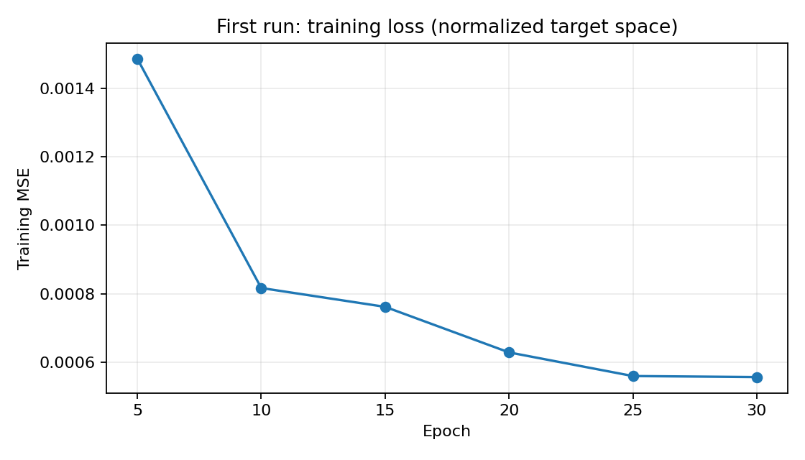
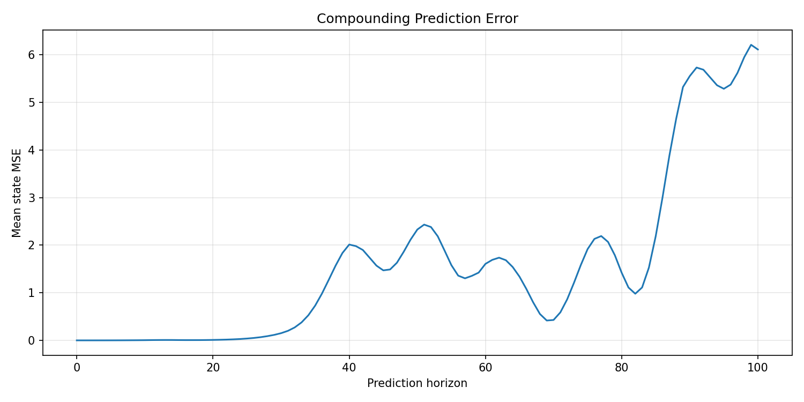
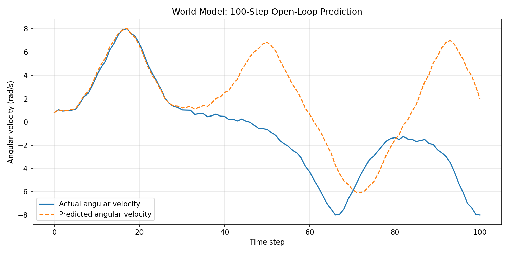

# Pendulum World Model Lab

A hands-on research learning log on **neural dynamics prediction, open-loop world-model evaluation, and model predictive control (MPC)** using PyTorch and Gymnasium's `Pendulum-v1` environment. The longer-term goal is to explore latent/visual world models and vision-language-action (VLA) policies.

The repository keeps **code, observed results, plots, and experiment notes** together. Reported measurements come from local experiments; they are not guaranteed to reproduce identically across machines or random samples.

## Progress

- [x] Configure Ubuntu, a Python virtual environment, and CUDA-enabled PyTorch
- [x] **Experiment 01:** Train and evaluate a one-step neural dynamics model
- [x] **Experiment 02:** Evaluate 100-step open-loop predictions
- [x] **Experiment 03:** Evaluate learned-model MPC against zero-torque and random baselines
- [x] **Experiment 04:** Compare MPC planning horizons (H=5, 10, 20) over 10 paired seeds
- [ ] **Experiment 05:** Compare random shooting and CEM with matched candidate-evaluation budgets
- [ ] Explore latent/visual world models
- [ ] Explore small VLA policies

## Environment

Experiments were performed on a Lenovo LOQ 15IRH8 with Ubuntu 22.04.5 LTS, Intel Core i5-13420H, approximately 16 GB RAM, and NVIDIA GeForce RTX 2050 (4 GB VRAM). The tested environment used Python 3.10.12, PyTorch `2.11.0+cu126`, and a working CUDA device. Larger models may require Google Colab or other cloud GPUs.

## Problem and learned dynamics model

`Pendulum-v1` exposes the observation

```text
s_t = [cos(theta_t), sin(theta_t), angular_velocity_t]
a_t in [-2, 2]  # continuous torque
```

The neural network receives `[s_t, a_t]` (four input values) and predicts a **state delta** (three output values):

```text
delta_s_t       = s_(t+1) - s_t
predicted_s_next = s_t + predicted_delta_s_t
```

Architecture: MLP `4 -> 128 -> 128 -> 3`, ReLU activations, Adam optimizer (learning rate `1e-3`), batch size 256. Training minimizes MSE of **normalized state deltas**. Normalization statistics are estimated from training data only. Train and test trajectories use distinct reset seeds.

## Setup

Run from the repository root:

```bash
python3 -m venv .venv
source .venv/bin/activate
python -m pip install --upgrade pip

# Install CUDA-enabled PyTorch using the official selector:
# https://pytorch.org/get-started/locally/
# The experiment machine used torch 2.11.0+cu126.
python -m pip install -r requirements.txt
python -c 'import torch; print(torch.__version__, torch.cuda.is_available())'
```

If you already have a working environment, activate it instead. On the original machine:

```bash
source ~/projects/world-models/.venv/bin/activate
```

Do not install a separate system-wide CUDA Toolkit just for these experiments unless a later dependency actually requires it. CPU execution is also possible for smaller runs.

## Reproduce the experiments

Run these from the **repository root** in order:

```bash
# Experiment 01: train the model and save its checkpoint
python src/train_one_step.py

# Plot six recorded points from the historical first run
python src/plot_first_run.py

# Experiment 02: 100-step open-loop predictions
python src/evaluate_rollout.py

# Experiment 03: receding-horizon, random-shooting MPC
python src/evaluate_mpc.py

# Experiment 04: paired comparison of planning horizons
python src/evaluate_horizons.py --episodes 10 --horizons 5 10 20
```

The training script saves its model and normalization statistics to `runs/one_step/pendulum_world_model.pt`. That path is the default checkpoint for the later experiments. Training runs and model weights are intentionally not committed to Git; observed results and figures are included under `results/`.

## Experiment 01 — One-step neural dynamics prediction

**Completed: October 25, 2026.** The historical first run used the tutorial script preserved as [`src/original_train_world_model.py`](src/original_train_world_model.py).

| Measurement | Observed value |
|---|---:|
| Training MSE, epoch 5 (normalized deltas) | 0.001486 |
| Training MSE, epoch 10 | 0.000817 |
| Training MSE, epoch 15 | 0.000762 |
| Training MSE, epoch 20 | 0.000629 |
| Training MSE, epoch 25 | 0.000560 |
| Training MSE, epoch 30 | 0.000557 |
| One-step test MSE (original state scale) | 0.0001419463 |
| No-change baseline MSE (original state scale) | 0.1061588004 |

The test MSE was approximately **748 times smaller** than the simple no-change baseline's MSE on that run. The baseline predicts `s_(t+1) = s_t`; because the target is `Y_test = s_(t+1) - s_t`, its squared error simplifies to `mean(Y_test ** 2)`.

**Important:** training MSE above is on *normalized deltas*, while test MSE is on the *original state scale*. Their numerical magnitudes must not be compared directly. The maintained training script reports comparable train/test metrics in matching spaces. The historical action sampling was not fully seeded, so reruns can differ.



## Experiment 02 — Multi-step open-loop prediction

**Completed: October 26, 2026.** The trained model was rolled forward recursively for 100 steps under the **same action sequences** applied to `Pendulum-v1`, across 10 independently initialized episodes. After the initial state, the predictor did not receive intermediate ground-truth states.

| Prediction step | Mean state MSE |
|---|---:|
| 1 | 0.000012 |
| 5 | 0.000564 |
| 10 | 0.004254 |
| 20 | 0.009564 |
| 50 | 2.329447 |
| 100 | 6.113632 |

One-step accuracy did **not** guarantee long-horizon accuracy: errors grew sharply on some trajectories. Plausible factors include compounding errors, distribution shift under recursive predictions, and the lack of an enforced `cos²(theta) + sin²(theta) = 1` constraint. These explanations have not yet been isolated experimentally.





[Detailed report — Experiment 02](docs/02-multi-step-prediction.md)

## Experiment 03 — Learned-model MPC

**Completed: October 28, 2026 (results received).** A receding-horizon, **random-shooting MPC** policy evaluated candidate torque sequences using the learned dynamics model. At each environment step, MPC selected the lowest-cost simulated sequence, executed **only its first action**, observed the actual next state, and replanned.

### Evaluation protocol

- Environment: `Pendulum-v1`, 200 steps per episode
- Shared environment reset seeds: `21000`, `21001`, `21002`
- Baselines: zero torque (`zero`) and uniformly random torque (`random`)
- MPC horizon: **10 steps**; candidate sequences: **256** per decision
- Actions: continuous torque in `[-2, 2]`
- Selection objective: cumulative `theta² + 0.1 * angular_velocity² + 0.001 * torque²` computed over *predicted next states*
- Primary metric: episode return (**higher / closer to zero is better**)

### Observed episode returns

| Seed | Zero torque | Random torque | Learned-model MPC |
|---|---:|---:|---:|
| 21000 | -503.69 | -637.70 | **-0.58** |
| 21001 | -481.39 | -955.82 | **-0.37** |
| 21002 | -1313.79 | -1269.40 | **-252.81** |
| **Mean ± population SD** | **-766.29 ± 387.25** | **-954.31 ± 257.89** | **-84.59 ± 118.95** |

MPC outperformed both baselines **on all three evaluated seeds**, achieving near-zero episode return on two. Performance was less consistent on seed `21002`; these three episodes are insufficient to establish robust or generalizable performance. The improvement in *mean episode return* versus the random baseline was approximately **869.72 reward points** (not a percent improvement).


The angle plot shows **only seed 21000** and should not be interpreted as evidence that all MPC episodes remained upright. The apparent jumps between `+pi` and `-pi` on baseline trajectories result from angle wrapping.

**Files:** `results/mpc/metrics.json`, `results/mpc/trajectories.csv`, `results/mpc/returns.png`, `results/mpc/angles.png`.

[Detailed report — Experiment 03](docs/03-model-predictive-control.md)

## Experiment 04 — MPC planning-horizon ablation

**Completed: October 29, 2026 (results supplied).** The same learned dynamics checkpoint was evaluated with random-shooting MPC on 10 paired environment reset seeds (`21000`–`21009`), 200 environment steps per episode, and 256 candidate action sequences per decision. Only the planning horizon changed (`H=5`, `H=10`, `H=20`). Results are exploratory, not a statistically conclusive benchmark.

| Horizon | Mean return ± SD | Median return | Mean final-50 stable fraction | Mean planning time |
|---|---:|---:|---:|---:|
| 5 | -849.57 ± 586.09 | -1065.38 | 30% | 0.8 ms |
| 10 | -223.34 ± 190.89 | -251.09 | 100% | 1.3 ms |
| 20 | -219.35 ± 221.94 | -124.38 | 100% | 2.5 ms |

Here a time step counts as *stable* if the wrapped angle magnitude is below `0.2 rad` **and** the angular-velocity magnitude is below `0.5 rad/s`. The stability percentage aggregates the fraction of the **last 50 steps** satisfying that diagnostic criterion; it is not a general safety guarantee. In this particular run, all ten H=10 and H=20 episodes reported a final-window fraction of `1.00`, while only three H=5 episodes did.

H=5 struggled to swing up from several initial states. H=10 and H=20 both achieved the final-window stability criterion across the tested seeds, but H=20's mean return advantage was only `3.99` points and its average planning time was approximately `1.9×` higher. H=10 had the better total return in six of ten paired episodes. Longer horizons also enlarge the action-sequence search space, so these results cannot isolate model-prediction error from random-shooting optimization difficulty.


The trajectory plot for seed `21002` illustrates that H=5 continued rotating while H=10 and H=20 approached and maintained the upright configuration later in the episode. Discontinuities at `±π` are caused by angle wrapping.

**Files:** `results/mpc_horizon_ablation/metrics.json`, `results/mpc_horizon_ablation/trajectories.csv`, and the two figures above.

[Detailed report — Experiment 04](docs/04-mpc-horizon-ablation.md)

## Interpretation and limitations

- One-step metrics, multi-step metrics, and MPC returns measure **different things** and should not be compared numerically as if they were the same metric.
- State MSE averages cosine, sine, and angular velocity terms, which have different physical scales; per-component errors should be inspected.
- The learned dynamics do not explicitly enforce `cos²(theta) + sin²(theta) = 1`.
- The MPC planning cost is an approximation to the environment objective: the code evaluates its cost on **predicted next states**, while the Gymnasium reward is calculated using the environment's current state. Do not describe the two as exactly identical.
- Random shooting is an approximate sequence optimizer. Increasing horizon also increases search difficulty when the number of sampled action sequences stays fixed.
- Experiment 03 evaluated only **three seeds** and Experiment 04 only **ten seeds**; the reported `±` values are across-seed standard deviations, **not confidence intervals**.
- The training data used random actions. Performance under planner-induced state distributions may differ.
- Exact results can vary across versions, seeds, GPU kernels, and action-sampling behavior.

## Next steps

1. **Experiment 05:** compare random shooting against Cross-Entropy Method (CEM) planning at `H=10` and `H=20`, holding the learned checkpoint fixed and matching the total number of evaluated candidate sequences per decision.
2. Expand to at least 20–30 paired seeds, and report per-seed returns, medians, variability, stabilization diagnostics, and computation time.
3. Investigate how planner optimization, initial conditions, and accumulated model error each contribute to failures; evaluate state-wise error and physical constraint violations.
4. Extend to latent/visual world models and lightweight VLA policies.

See [the roadmap](docs/roadmap.md) for longer-term work.

## Repository layout

```text
pendulum-world-model-lab/
├── README.md
├── LICENSE
├── requirements.txt
├── .gitignore
├── src/
│   ├── original_train_world_model.py
│   ├── train_one_step.py
│   ├── plot_first_run.py
│   ├── evaluate_rollout.py
│   ├── evaluate_mpc.py
│   └── evaluate_horizons.py
├── docs/
│   ├── roadmap.md
│   ├── 02-multi-step-prediction.md
│   ├── 03-model-predictive-control.md
│   └── 04-mpc-horizon-ablation.md
├── results/
│   ├── first_run_observed.json
│   ├── first_run_training_curve.png
│   ├── multi_step/
│   │   ├── rollout_error.png
│   │   └── rollout_comparison.png
│   └── mpc/
│       ├── metrics.json
│       ├── trajectories.csv
│       ├── returns.png
│       └── angles.png
│   └── mpc_horizon_ablation/
│       ├── metrics.json
│       ├── trajectories.csv
│       ├── horizon_returns.png
│       └── seed_21002_angles.png
└── runs/                  # generated locally; excluded by .gitignore
    └── one_step/
        └── pendulum_world_model.pt
```

If a figure has not yet been generated or committed, its README image link will remain empty until that file is added. Run the corresponding script from the repository root.

## License

MIT — see [LICENSE](LICENSE).
