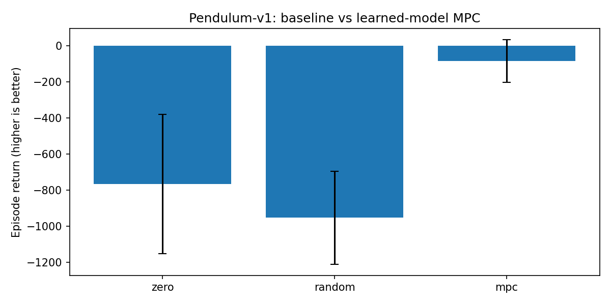
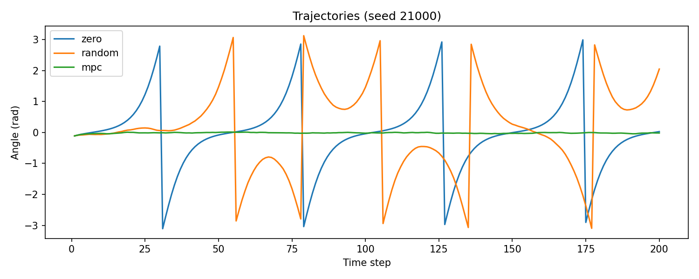

# Experiment 03 — Learned-Model MPC

## Research question

Does the one-step neural dynamics model improve **closed-loop control** over a zero-torque or random-action policy, despite long-horizon rollout drift?

## Method

- Environment: Gymnasium `Pendulum-v1`.
- Predictor: the frozen, previously trained one-step MLP world model.
- Planner: vectorized **random shooting** (sample action sequences, predict their outcomes, pick the cheapest sequence).
- Objective: sum of predicted Pendulum costs, `theta^2 + 0.1 * angular_velocity^2 + 0.001 * torque^2`.
- Receding horizon: only the first action is executed, then the true observed state is used to replan.
- Policies: `zero`, `random`, and learned-model `mpc`.
- Fair comparison: identical reset seeds across policies; their subsequent states differ because actions differ.
- Default: 3 episode seeds, 200 steps each, horizon 10, 256 action sequences per plan.

## Run

From the repository root, with the Python environment activated:

```bash
python src/evaluate_mpc.py
```

Optional alternative checkpoint path:

```bash
python src/evaluate_mpc.py --checkpoint /absolute/path/to/pendulum_world_model.pt
```

More candidates and horizons increase computational cost:

```bash
python src/evaluate_mpc.py --horizon 15 --candidates 512 --episodes 5
```

## Results

**Fill in after running the experiment; do not invent numbers.**

| Policy | Mean episode return ± SD |
|---|---|
| Zero torque | TBD |
| Random | TBD |
| World-model MPC | TBD |





Detailed machine-readable results are stored in `results/mpc/metrics.json` and `results/mpc/trajectories.csv`.

## Interpretation and limitations

A strong one-step predictor may still perform poorly as a planner, particularly when sampled action sequences are too short or fail to include useful swing-up strategies. Random-shooting MPC is only a *baseline planner*, not guaranteed to stabilize the pendulum. Results across three seeds are exploratory, not a statistical claim. The neural model was trained on random-action data, and its predicted state is not constrained to a physically valid manifold.

## Next experiments

1. Compare planning horizons 5, 10, and 20.
2. Replace random shooting with CEM for more targeted action-sequence optimization.
3. Compare against a controller using true simulator dynamics as an approximate oracle (without giving the learned MPC simulator information at planning time).
4. Analyze short-horizon model error along the trajectories *visited by the MPC policy*.
