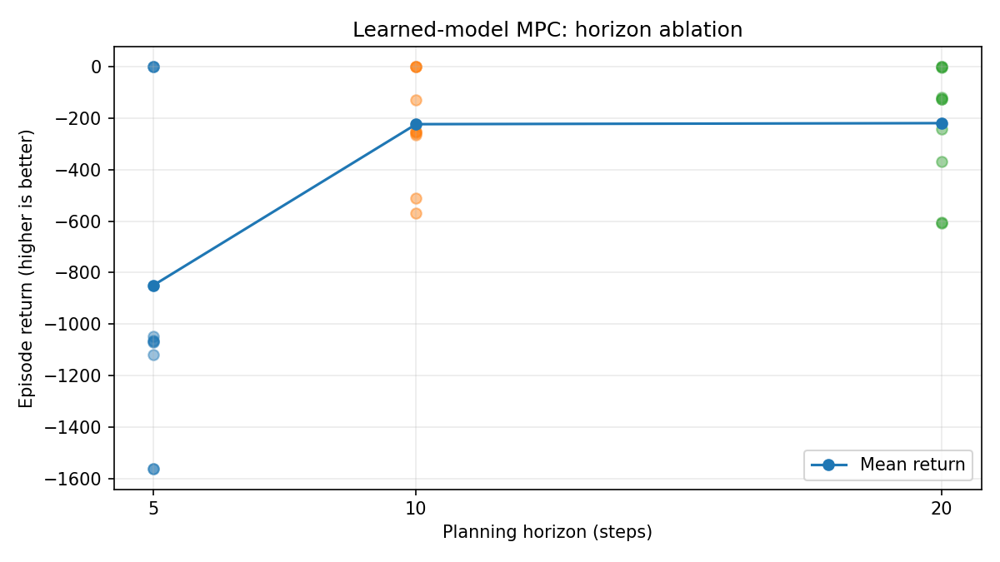
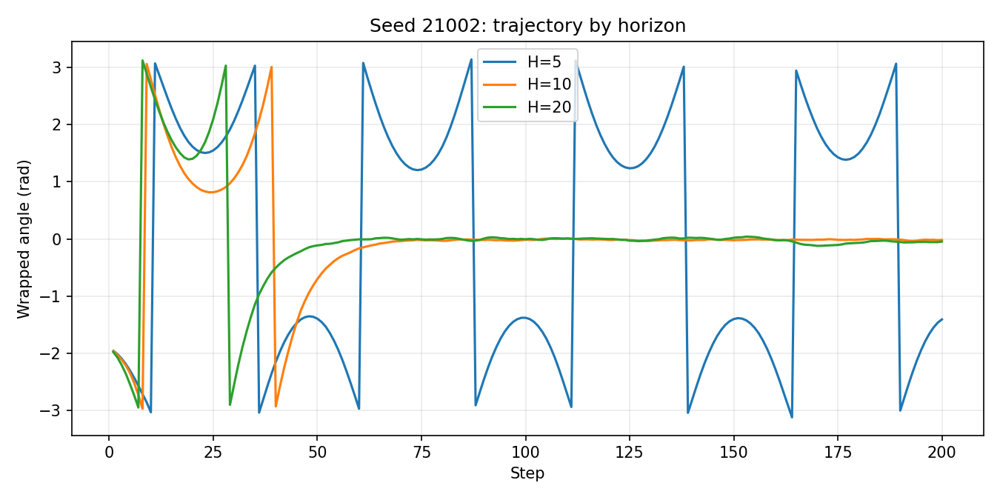

# Experiment 04 — MPC Planning-Horizon Ablation

**Status:** Completed (10-seed exploratory evaluation, October 29, 2026)

## Research question

How does the planning horizon affect the closed-loop performance and computation cost of random-shooting MPC using the **same learned Pendulum dynamics model**?

## Experimental protocol

- **Environment:** Gymnasium `Pendulum-v1` with 200 environment steps per episode.
- **World model:** the same trained one-step MLP checkpoint for all configurations, `runs/one_step/pendulum_world_model.pt`.
- **Planner:** receding-horizon random shooting; 256 sampled candidate action sequences per decision, followed by execution of only the first action from the selected sequence.
- **Planning horizons:** 5, 10, and 20 steps (0.25, 0.50, and 1.00 seconds of simulated lookahead, respectively, using `Pendulum-v1`'s 0.05-second time step).
- **Evaluation seeds:** paired environment reset seeds `21000` through `21009`; each horizon is evaluated on the same set of initial conditions. Different horizon configurations can produce different closed-loop trajectories and sampled controls.
- **Planner objective:** sum of predicted next-state Pendulum-like costs over the horizon. The simulator's realized rewards are collected independently for evaluation.
- **Metrics:** episode return (higher is better), mean and median return across seeds, across-seed standard deviation, mean fraction of stable time steps in each episode's final 50 steps, and average planning time per decision.
- **Diagnostic stability rule:** `abs(wrapped_angle) < 0.2 rad` **and** `abs(angular_velocity) < 0.5 rad/s` at a given time step. This is a chosen evaluation threshold, not a proof of stability or safety.

The candidate count is held constant, but the compute budget is **not**: larger horizons require longer predicted rollouts. With a fixed count of samples, larger horizons also have a higher-dimensional search space.

## Reproduce

Run from the repository root with the trained checkpoint available:

```bash
python src/evaluate_horizons.py --episodes 10 --horizons 5 10 20
```

Optional larger evaluation (results not reported here):

```bash
python src/evaluate_horizons.py --episodes 30 --horizons 5 10 20
```

The script writes outputs under `results/mpc_horizon_ablation/`:

- `metrics.json` — summary statistics and per-seed results
- `trajectories.csv` — recorded closed-loop trajectories
- `horizon_returns.png` — per-seed episode returns and mean by horizon
- `seed_21002_angles.png` — wrapped-angle comparison at a challenging initial condition

## Observed results

Values below are transcribed from the supplied local terminal run; they should not be interpreted as results independently rerun in this document.

| Horizon | Mean return ± SD | Median return | Mean final-50 stable fraction | Mean planning time |
|---|---:|---:|---:|---:|
| 5 | -849.57 ± 586.09 | -1065.38 | 30% | 0.8 ms |
| 10 | -223.34 ± 190.89 | -251.09 | 100% | 1.3 ms |
| 20 | -219.35 ± 221.94 | -124.38 | 100% | 2.5 ms |

Here `SD` denotes the across-seed standard deviation reported by the script, not a confidence interval. The stability column is the **mean of the per-episode fractions of qualifying steps in the final 50 steps**, rather than a separate statistical proof of convergence. For this run, the reported per-episode fractions were 0 or 1; H=5 had three episodes with a value of 1, and H=10/H=20 had ten each.

### Per-seed return comparison

| Seed | H=5 | H=10 | H=20 |
|---|---:|---:|---:|
| 21000 | -0.33 | -0.58 | -1.19 |
| 21001 | -0.17 | -0.39 | -0.89 |
| 21002 | -1064.37 | -251.28 | -240.88 |
| 21003 | -0.78 | -0.97 | -1.39 |
| 21004 | -1066.40 | -257.30 | -124.33 |
| 21005 | -1070.57 | -250.89 | -119.30 |
| 21006 | -1563.82 | -570.20 | -604.62 |
| 21007 | -1048.64 | -128.25 | -124.43 |
| 21008 | -1562.26 | -509.54 | -607.04 |
| 21009 | -1118.32 | -264.02 | -369.42 |





## Findings and interpretation

1. **H=5 was too short for reliable swing-up in this sample.** It met the final-50-step stability criterion in just 3 of 10 episodes and had much lower mean and median returns.
2. **H=10 and H=20 both met the final-window criterion in all 10 tested episodes.** This is evidence about these initial conditions and this diagnostic, not a guarantee of general stabilization.
3. **H=20 did not consistently beat H=10.** The mean-return difference was only `3.99` points in favor of H=20; H=10 produced a better return in six of ten paired seeds. The distribution of outcomes and initialization matter more than that small mean difference alone.
4. **Longer planning increased measured computation time.** Average planning time rose from 1.3 ms at H=10 to 2.5 ms at H=20, or roughly 1.9 times as much.
5. **Seed 21002 illustrates the value of sufficient lookahead.** In its wrapped-angle trajectories, H=5 continued rotating rather than settling upright, while H=10 and H=20 reached and maintained angles near zero later in the episode. Jumps at `±π` are display wrapping, not physical jumps.

## Limitations

- Only 10 paired seeds were evaluated. No formal uncertainty intervals or significance tests were performed.
- Random shooting is an approximate planner. At fixed 256 candidates, longer horizons make optimization harder, so a change in return cannot be attributed uniquely to world-model prediction error.
- Planning-time figures are machine- and implementation-dependent, and equal numbers of candidate *sequences* do not imply equal numbers of model evaluations.
- The planning objective uses predicted next states whereas Gymnasium's realized reward is evaluated at the environment state before the action. They are related but not mathematically identical objectives.
- The learned model does not explicitly enforce the Pendulum observation constraint `cos²(theta) + sin²(theta) = 1`.
- Tail stability, episode return, and model-prediction accuracy are different measures; success on one does not imply success on the others.

## Next experiment — Random Shooting vs. CEM

Keep the same world-model checkpoint and compare Random Shooting against Cross-Entropy Method (CEM) at horizons 10 and 20 using matched numbers of **evaluated candidate sequences** per decision. Measure return, stabilization, and actual compute time over a larger paired-seed set. Matching sequence counts does not guarantee identical wall-clock costs, so both metrics should be reported.
