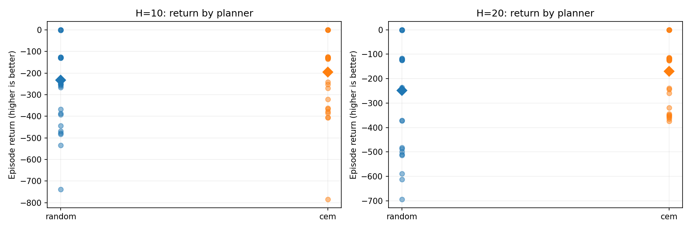
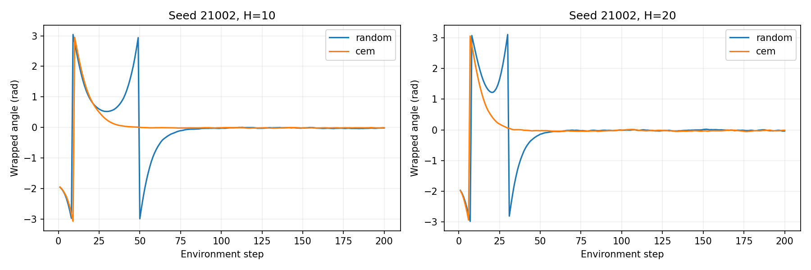

# Experiment 05 — Random Shooting vs. Cross-Entropy Method (CEM)

**Status:** Completed — results reported November 1, 2026.

## Research question

Does iterative proposal refinement with CEM improve closed-loop control over uniform Random Shooting when the learned dynamics checkpoint, prediction objective, planning horizon, and **number of evaluated action sequences per decision** are held fixed?

## Experimental protocol

- **Environment:** Gymnasium `Pendulum-v1`; 200 environment steps per episode.
- **World model:** the same trained one-step state-delta MLP checkpoint for all runs (`runs/one_step/pendulum_world_model.pt`). No retraining.
- **Evaluation:** 30 paired environment reset seeds, `21000`–`21029`, for each horizon and planner (120 episodes total).
- **Horizons:** `H=10` and `H=20`.
- **Random Shooting:** 1,024 uniformly sampled action sequences per planning decision.
- **CEM:** four consecutive rounds of 256 sequences; 10% elite fraction. The first round is uniform over the action bounds; subsequent rounds use per-time-step Gaussian proposals fitted to the elite sequences, with action clipping and a standard-deviation floor of 0.1.
- **Action bounds:** `[-2, 2]` (torque).
- **Planner objective:** identical cumulative predicted-next-state cost for both methods, using wrapped angle, angular velocity and applied torque. The simulator's actual episode return is recorded separately.
- **MPC procedure:** execute only the first action of the chosen sequence; observe the real next state and replan.
- **Diagnostic stability criterion:** `abs(wrapped_angle) < 0.2 rad` and `abs(angular_velocity) < 0.5 rad/s`. `tail` is the fraction of the *last 50 steps* meeting both thresholds, not a measure of full-episode stability or a safety guarantee.
- **Compute:** NVIDIA RTX 2050 (4 GB); planner timing is average wall-clock time per decision as reported by the script.

The protocols match candidate **sequence counts**, not total neural-model forward computations or elapsed planning time. A horizon of 20 requires more model steps than a horizon of 10, and CEM adds sequential sampling and fitting overhead. Internal random draws across planners are not identical.

## Reproduction

From the repository root, with the existing Python environment activated:

```bash
python src/compare_planners.py --episodes 30 --horizons 10 20
```

Generated files in `results/mpc_planner_comparison/`:

- `metrics.json` — configuration and aggregate/per-episode metrics
- `trajectories.csv` — recorded environment transitions and planning-time information
- `planner_returns.png` — individual returns and mean markers, by horizon and planner
- `seed_21002_angles.png` — illustrative wrapped-angle trajectories for seed 21002

## Observed results

The table below transcribes the actual 30-seed terminal summary. `±` denotes **across-seed standard deviation**, not a confidence interval.

| Horizon | Planner | Mean return ± SD | Median return | Mean final-50 stable fraction | Mean planning time |
|---|---|---:|---:|---:|---:|
| 10 | Random Shooting | -232.52 ± 188.33 | -189.47 | 100.0% | 1.5 ms |
| 10 | CEM | **-195.03 ± 170.72** | -129.81 | 100.0% | 6.3 ms |
| 20 | Random Shooting | -248.11 ± 208.56 | -180.49 | 100.0% | 2.8 ms |
| 20 | CEM | **-170.53 ± 127.97** | -121.68 | 100.0% | 11.5 ms |

**Average-return differences (CEM − Random Shooting; positive means better):**

- `H=10`: **+37.49 reward points**; CEM planning time approximately **4.2×** Random Shooting.
- `H=20`: **+77.58 reward points**; CEM planning time approximately **4.1×** Random Shooting.

These are descriptive differences for this checkpoint, sampler configuration and seed set; they do **not** establish statistical significance or universal superiority.

### Return distributions



CEM achieved a higher mean return at both horizons. Returns varied widely across initial states and CEM was not better on every seed. The H=20 CEM distribution showed fewer very poor outcomes in this run.

### Example: seed 21002



For seed `21002`, CEM reached the neighborhood of the upright angle earlier than Random Shooting in both horizon configurations, reducing accumulated negative reward. Approximate arrival times inferred visually from these wrapped-angle plots are not a formally defined stabilization-time metric.

Recorded returns for this seed:

| Horizon | Random Shooting | CEM |
|---|---:|---:|
| 10 | -253.50 | **-129.22** |
| 20 | -241.89 | **-116.37** |

### Counterexample: seed 21014

CEM was not uniformly superior. At horizon 10, it performed considerably worse:

| Horizon | Random Shooting | CEM |
|---|---:|---:|
| 10 | **-469.31** | -784.40 |
| 20 | -372.43 | **-365.06** |

This is a useful follow-up case for examining proposal collapse, elite selection, action sequences, and sensitivity to random sampling. The present data do not identify the cause.

## Interpretation

1. **Planner choice matters:** improved mean returns were obtained without changing the world-model parameters.
2. **The horizon interacts with the optimizer:** CEM improved mean return more at `H=20` than at `H=10` in this evaluation.
3. **Compute cost matters:** CEM took roughly four times as long per planning decision. Matching sequence counts alone does not match wall-clock cost.
4. **Tail stability is not sufficient to characterize performance:** all four configurations achieved 100% mean final-window stability in the reported run, despite substantial differences in episode return. Transient swing-up costs and time to stabilization matter.

## Limitations

- The evaluation uses one trained world model and 30 environment seeds, not multiple training seeds or independent model checkpoints.
- The study reports descriptive across-seed summaries; no paired confidence intervals or inferential statistical tests were calculated.
- Planning randomness is not separately replicated; differences can depend on internal action-sampling draws.
- The same number of candidate sequences does not equalize wall-clock time, sequential overhead, or computation across horizons.
- CEM's per-step Gaussian proposals and hyperparameters are only one possible implementation; results may change with elite fraction, iterations, warm starts or variance floors.
- Predicted-next-state planning cost is not identical to Gymnasium's pre-action reward definition.
- The reported stability criterion applies only to the last 50 steps; it cannot establish whole-episode success, safety, or robustness.
- The plot for seed 21002 illustrates one trajectory, not the full distribution of behavior.

## Next experiment — Improving world-model rollout accuracy

Keep planner settings fixed while comparing: (1) the original one-step model, (2) unit-circle projection, (3) multi-step training loss, and (4) both modifications together. Evaluate one-step and multi-step errors **and** closed-loop returns; better long-horizon MSE need not imply better control.
