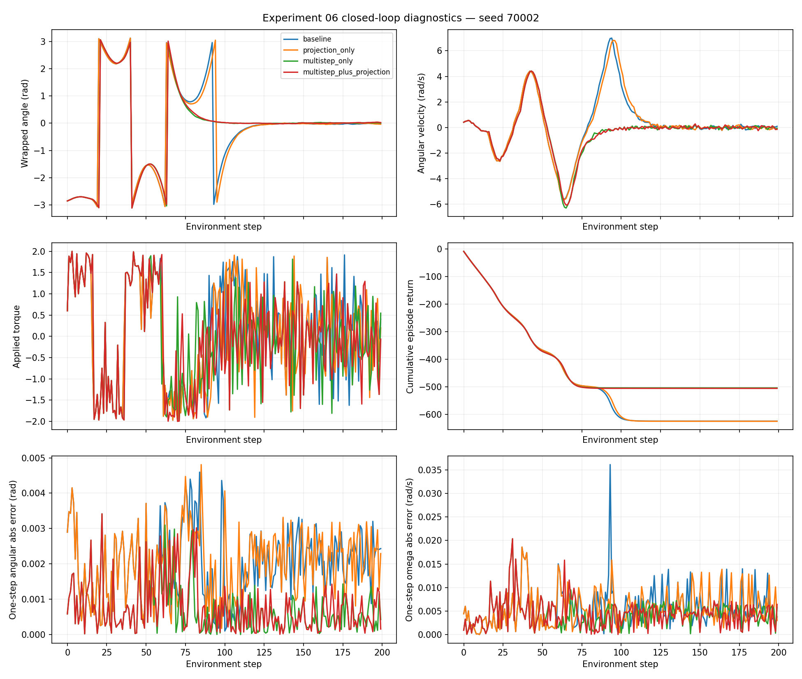
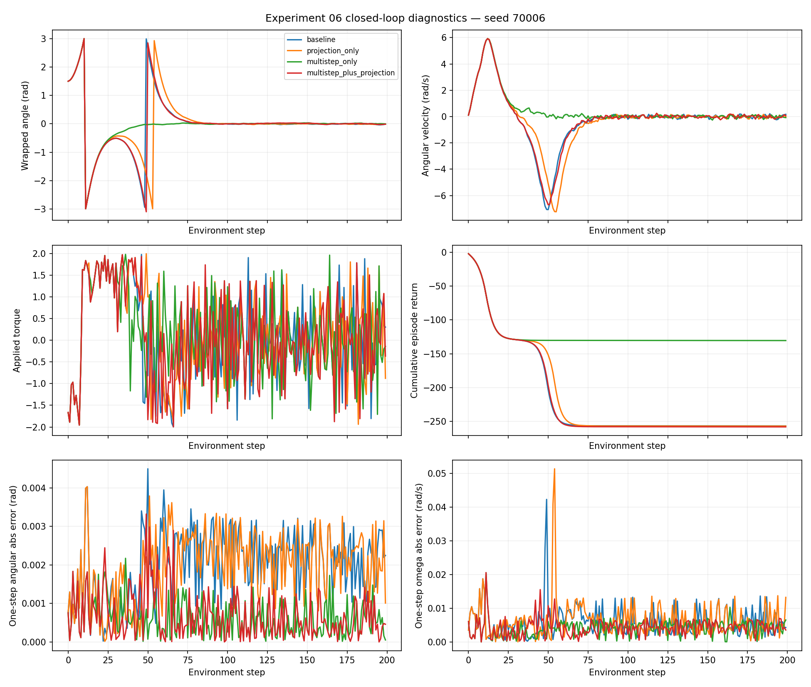

# Experiment 06 — Closed-Loop Diagnostics

## Motivation

The overall MPC numbers from Experiment 06 hid substantial differences between initial conditions. I therefore revisited seeds `70002` and `70006` to understand when the controllers approached upright and where their returns separated.

## Reproduction

I loaded the already-trained one-step and multi-step checkpoints and reran the four configurations with the original MPC settings (H=10, 256 random-shooting candidates, 200 environment steps). I logged actual wrapped angle, angular velocity, applied torque, cumulative reward, and the error of a one-step prediction for the action that was actually executed. I did not retrain either model.

```bash
python src/diagnose_experiment06.py --seeds 70002 70006
python src/find_projection_divergence.py --seeds 70002 70006
```

The rerun returns matched the original recorded returns to the printed precision (`difference=+0.000000` in all eight runs).

## Results

| Variant | Return: 70002 | Return: 70006 |
|---|---:|---:|
| Baseline | -625.060 | -256.461 |
| Projection only | -625.660 | -256.671 |
| Multi-step only | -504.481 | -130.416 |
| Multi-step + projection | -506.105 | -257.824 |

For seed `70002`, both multi-step variants avoided an additional high-velocity motion around the later swing-up portion of the episode. For seed `70006`, the unprojected multi-step variant approached upright substantially sooner; projection was associated with an extra large swing. The final 50-step stability fraction was 1.00 for all four methods on both seeds, so the performance gap was mostly accumulated before the final stabilized period.





## First divergence in the original trajectories

I compared logged actions and actual pre-action states for the two fine-tuned variants, using a torque-difference threshold of `1e-3` and angle/velocity thresholds of `1e-4`.

| Seed | First torque difference | First actual state difference | Torques at first difference (OFF / ON) | Final return gap (ON − OFF) |
|---|---:|---:|---|---:|
| 70002 | 53 | 54 | +1.89476 / +1.41864 | -1.624119 |
| 70006 | 14 | 15 | +1.38520 / +0.88099 | -127.408366 |

The states were still identical at each first divergent action. The numerical threshold was crossed in the next actual state. The difference in cumulative return subsequently grew as the controllers followed different paths. I cannot infer the exact internal candidate-cost explanation from the logged best actions alone.

## Limits of this diagnostic

The one-step prediction-error curves are measured on each controller's *own* closed-loop trajectory, which means that differences in visited states can confound direct comparisons of model accuracy. The apparent instantaneous angle jumps at ±π are angle wrapping rather than physical discontinuities. I use these trajectories to interpret the control results alongside the open-loop evaluation in the main Experiment 06 report.
