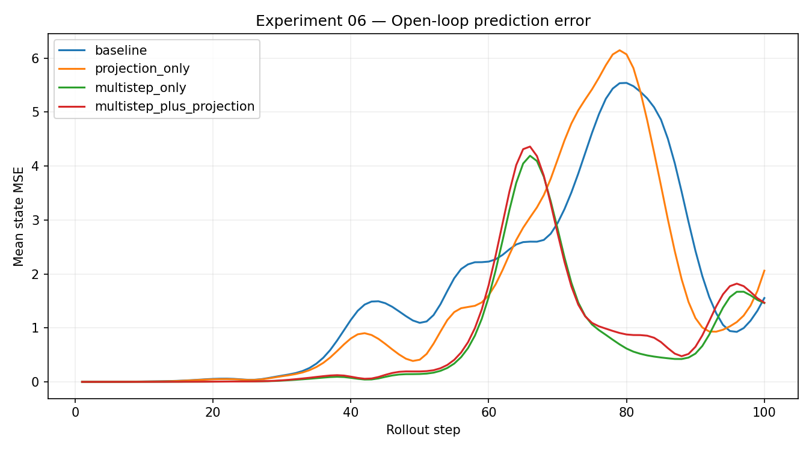
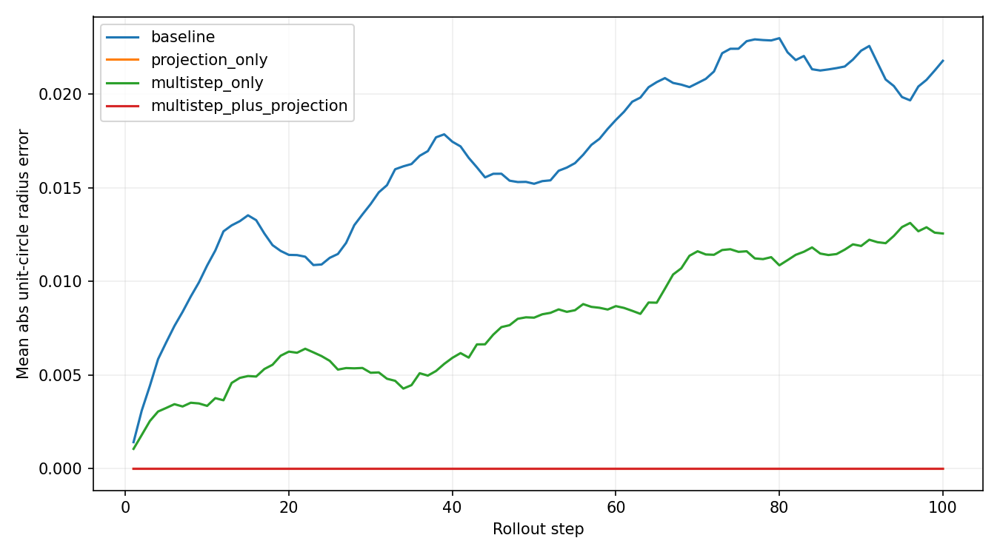
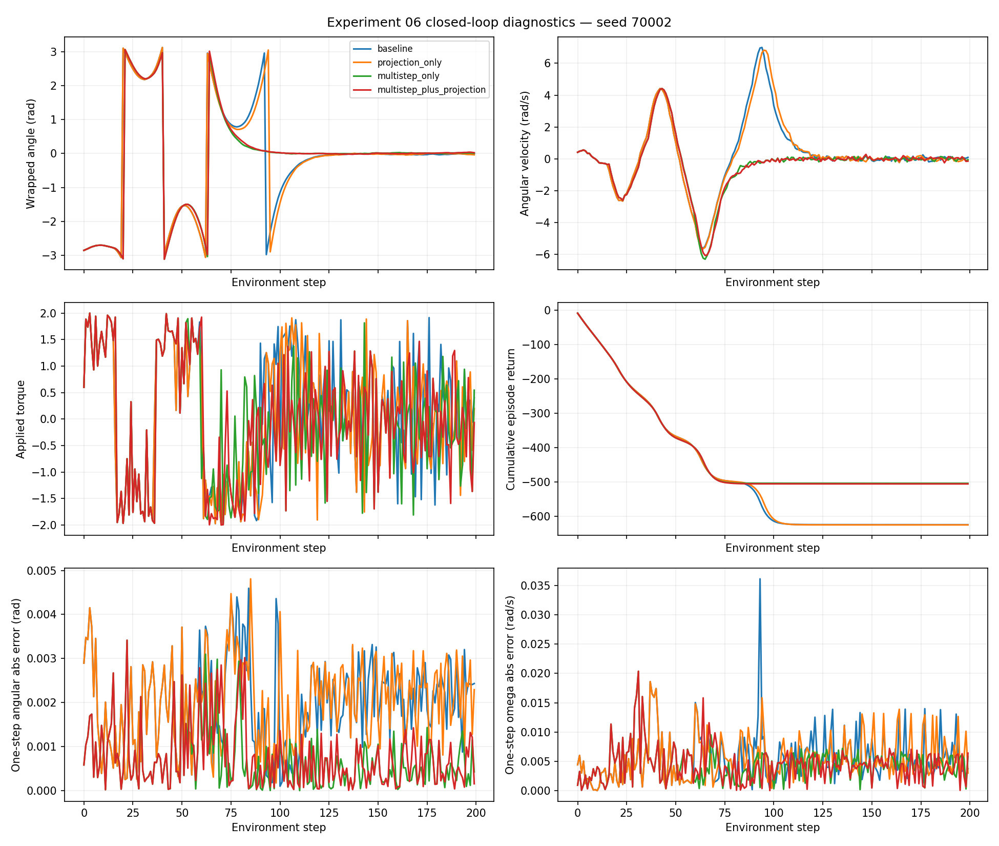
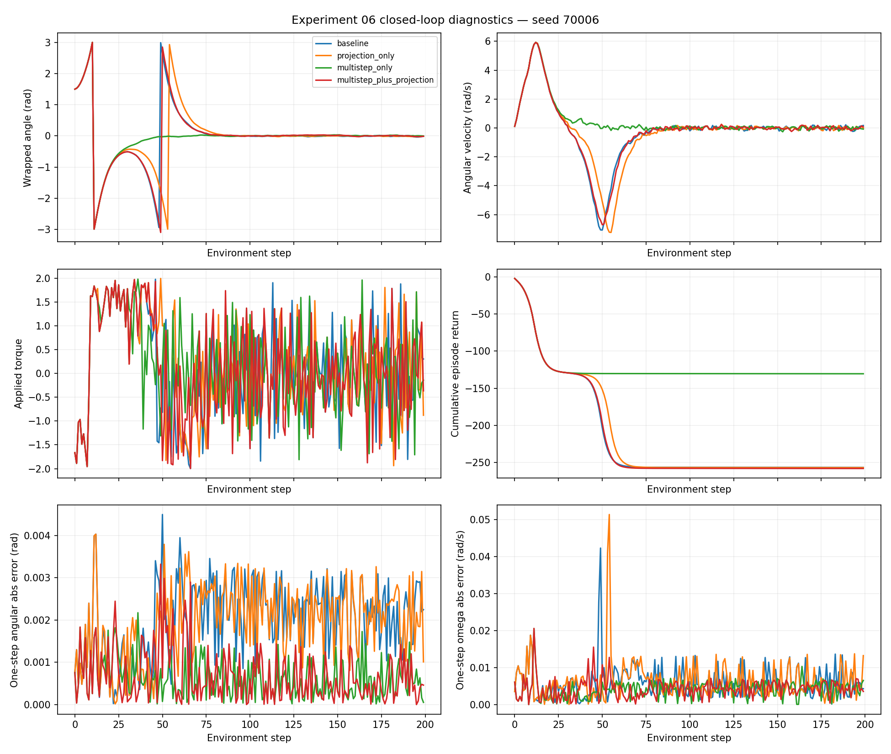

# Experiment 06 — Improving World Model Rollout Accuracy

## Objective

I wanted to test whether a world model trained beyond one-step prediction would produce more accurate open-loop rollouts, and whether this would improve its usefulness for model predictive control (MPC). I also tested whether normalizing the predicted cosine/sine coordinates to the unit circle would help.

## Setup

I used the same `Pendulum-v1` observation, `[cos(theta), sin(theta), angular_velocity]`, and the same MLP architecture (`4 → 128 → 128 → 3`). I compared two sets of weights, each with projection disabled or enabled at inference:

| Variant | Weights | Unit-circle projection during inference |
|---|---|---|
| `baseline` | Original one-step model | No |
| `projection_only` | Original one-step model | Yes |
| `multistep_only` | Model fine-tuned with a five-step rollout loss | No |
| `multistep_plus_projection` | Same fine-tuned model | Yes |

The two multi-step variants **share weights**. This experiment does not compare four separately trained networks. For fine-tuning, I used 15 epochs, 100 training episodes, five-step training horizon, batch size 128, 40 batches per epoch, and learning rate `2e-4`. `train_projection=false`, so projection was not used in fine-tuning.

I evaluated open-loop prediction on 20 held-out trajectories over 100 steps, with common initial conditions and action sequences. I then evaluated all four variants with random-shooting MPC on 10 common environment reset seeds (`70000`–`70009`), planning horizon 10 and 256 candidate action sequences per step. The return results refer to closed-loop execution in Gymnasium, not model-predicted returns.

Run from the repository root:

```bash
python src/experiment06.py --epochs 15 --train-episodes 100 \
  --train-horizon 5 --eval-episodes 20 --rollout-horizon 100 \
  --mpc-episodes 10
```

## Open-loop prediction

The state MSE is averaged over the three observation coordinates. The coordinates have different physical scales, so I do not treat this aggregate as a complete physical error measure.

| Variant | H=1 | H=5 | H=10 | H=20 | H=50 | H=100 |
|---|---:|---:|---:|---:|---:|---:|
| Baseline | 0.00001 | 0.00089 | 0.00690 | 0.05513 | 1.09356 | 1.55375 |
| Projection only | 0.00001 | 0.00075 | 0.00551 | 0.04750 | 0.41052 | 2.06025 |
| Multi-step only | 0.00001 | 0.00011 | 0.00038 | 0.00468 | 0.14542 | 1.46073 |
| Multi-step + projection | 0.00001 | 0.00011 | 0.00030 | 0.00436 | 0.19291 | 1.46651 |

Five-step fine-tuning reduced rollout MSE substantially in the short and medium horizons. Relative to the baseline, `multistep_only` reduced MSE by about 91.5% at H=20 and 86.7% at H=50. At H=100, however, its improvement was much smaller. The error curves also show substantial non-monotonic variation over long rollouts.



Projection kept `sqrt(cos²(theta) + sin²(theta))` approximately equal to one (up to floating-point precision). However, geometric validity alone did not imply accurate angles or angular velocities. The projection-only model had a worse H=100 MSE than the baseline.



## MPC evaluation

| Variant | Mean episode return ± population SD (10 seeds) |
|---|---:|
| Baseline | -164.685 ± 168.004 |
| Projection only | -164.702 ± 168.193 |
| Multi-step only | **-140.001 ± 131.313** |
| Multi-step + projection | -152.879 ± 136.295 |

Higher returns are better. The mean improved with multi-step fine-tuning, but looking at the paired episodes showed that almost all of this difference came from two initial conditions:

| Seed | Baseline | Multi-step only | Change (multi-step minus baseline) |
|---|---:|---:|---:|
| 70002 | -625.060 | -504.481 | +120.579 |
| 70006 | -256.461 | -130.416 | +126.045 |

The other eight paired differences were small. This is not enough evidence to claim robust superiority over unseen initial conditions. With projection enabled on the fine-tuned model, seed `70006` returned `-257.824` instead of `-130.416`, explaining nearly all of the difference between the multi-step variants' mean returns.

## Closed-loop diagnostics

I reran the four configurations for seeds `70002` and `70006`, without retraining, while logging actual states, actions, rewards and one-step prediction errors. All eight reruns matched the original saved episode returns to the displayed precision (the script reported zero numerical differences).

For seed `70002`, the multi-step variants avoided an additional costly rotation seen with the original model. For seed `70006`, the unprojected multi-step variant settled near upright sooner; the projected variant made an additional large movement before stabilizing. All four variants met the final-window stability criterion in both investigated episodes. The return differences therefore mostly arose during the transient trajectory, not the final balance period.





The one-step errors on these trajectories cannot be compared as if the models were evaluated on identical state-action distributions: their policies may choose different actions and visit different states. See [Closed-loop diagnostics](06-closed-loop-diagnostics.md).

## Projection and action selection

To isolate projection's effect on scoring, I compared 26 identical states and newly sampled candidate action banks from seed `70006`, at steps 30–55. No winning sequence changed; the mean absolute difference in first torque was zero at the reported precision, and the mean Spearman cost-rank correlation was approximately 1.0. That did **not** reproduce the original internal candidate banks.

Next, I compared the original closed-loop trajectories and found that the first action difference for seed `70006` had already occurred at step **14**, before that counterfactual window. At step 14, with identical actual states, the chosen torques were **+1.38520 without projection** and **+0.88099 with projection**. The actual states first differed above the chosen threshold in step 15. For seed `70002`, the first action difference was at step **53** (+1.89476 versus +1.41864), with the first state difference at step 54.

| Seed | First action divergence | First state divergence | Return (projection ON minus OFF) |
|---|---:|---:|---:|
| 70002 | 53 | 54 | -1.624119 |
| 70006 | 14 | 15 | -127.408366 |

These findings locate where the closed-loop trajectories separated. I have **not** replayed the exact original candidate costs at those first-divergence steps, so I cannot establish the precise mechanism of the changed selection or attribute the entire return difference to one action. See [Projection counterfactual analysis](06-projection-counterfactual.md).

## Interpretation and limitations

I found that five-step fine-tuning improved short- and medium-horizon predictions; this coincided with better average MPC returns in this small evaluation. But the return benefit was concentrated in two seeds, and adding a physical constraint during inference did not consistently improve control. A projected state can lie on the unit circle while still representing the wrong angle. Small differences in predicted costs may also affect which action a planner selects.

The study uses 20 open-loop evaluation trajectories, 10 closed-loop reset seeds, and a single fine-tuning run. I have not measured uncertainty over training seeds, compared model errors on a common set of planner-induced state-action pairs, or reconstructed the exact candidate banks at the first divergent MPC steps. The observations support a careful, local conclusion rather than a general claim that better prediction automatically yields better control.

## Files and next step

- Main experiment: `src/experiment06.py`; summary: `results/experiment_06/metrics.json`
- Diagnostics: `src/diagnose_experiment06.py`; output: `results/experiment_06/diagnostics/`
- Shared-input comparison: `src/analyze_projection_counterfactual.py`; output: `results/experiment_06/counterfactual/`
- Original trajectory divergence check: `src/find_projection_divergence.py`
- The fine-tuned checkpoint is `results/experiment_06/multistep_world_model.pt`, a local generated artifact that should remain outside Git when `*.pt` is ignored.

My next implementation will move beyond direct three-dimensional state prediction to a compact recurrent latent-state model, as preparation for RSSM-style world models. The current experiment is complete; I do not need to extend it with more diagnostic scripts before that step.
