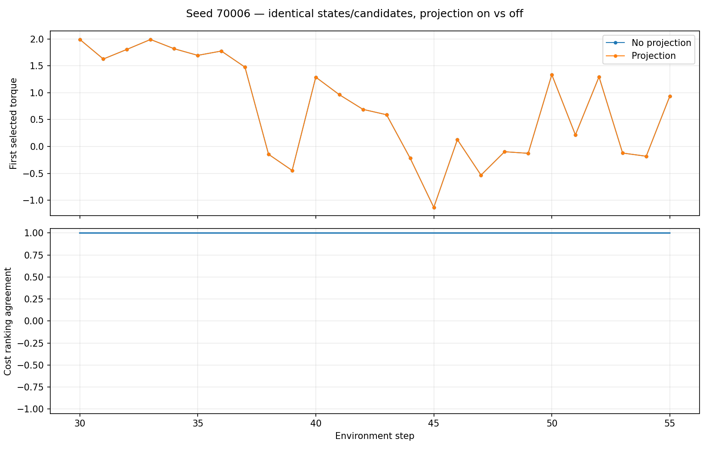

# Experiment 06 — Projection Counterfactual Analysis

## Objective

I tested whether switching on unit-circle projection changes the action selected by the *same* multi-step-trained model when the starting state and candidate action sequences are held fixed.

## Protocol

I used stored pre-action states from the unprojected multi-step controller's seed `70006` trajectory, steps 30–55 inclusive. For each of the 26 states, I generated one reproducible bank of 256 ten-step action sequences. I evaluated that same bank twice with the same model weights, with projection off and on. I sampled new candidate banks for this test rather than reusing those from the original closed-loop run.

```bash
python src/analyze_projection_counterfactual.py --seed 70006 --steps 30 55
```

## Results

| Metric | Result |
|---|---:|
| States tested | 26 |
| Different winning sequences | 0 / 26 |
| Mean absolute difference between selected first actions | 0.0000 |
| Mean Spearman cost-rank correlation | ≈ 1.0000 |



On this particular collection of states and candidate sequences, projection did not change the selected first action. I cannot generalize this observation to all encountered states or all randomly drawn candidate banks.

## Comparison with the closed-loop trajectories

The trajectory-divergence check subsequently showed that the *original* projected and unprojected controllers first chose different actions at step **14** in seed `70006`, while the above counterfactual window started at step 30. For seed `70002`, the first difference was at step 53. Thus the two evaluations answer different questions: the counterfactual check compares scoring on newly sampled, identical inputs; the original-trajectory check locates when the two complete MPC executions first separated.

At seed `70006`, step 14, the controllers were in identical actual states but selected torques +1.38520 (OFF) and +0.88099 (ON). The state trajectories first diverged above the diagnostic threshold at step 15, and their final return difference was -127.408366 (ON − OFF). That observation is compatible with projection influencing planning, but I did **not** log and replay the exact original candidate costs at step 14. I therefore cannot claim to have isolated the detailed mechanism of the action change or the causal contribution of that single step to the final episode return.

The candidate-ranking check and the closed-loop divergence analysis examine different aspects of projection; neither reconstructs the original candidate scores at the first divergent step.
